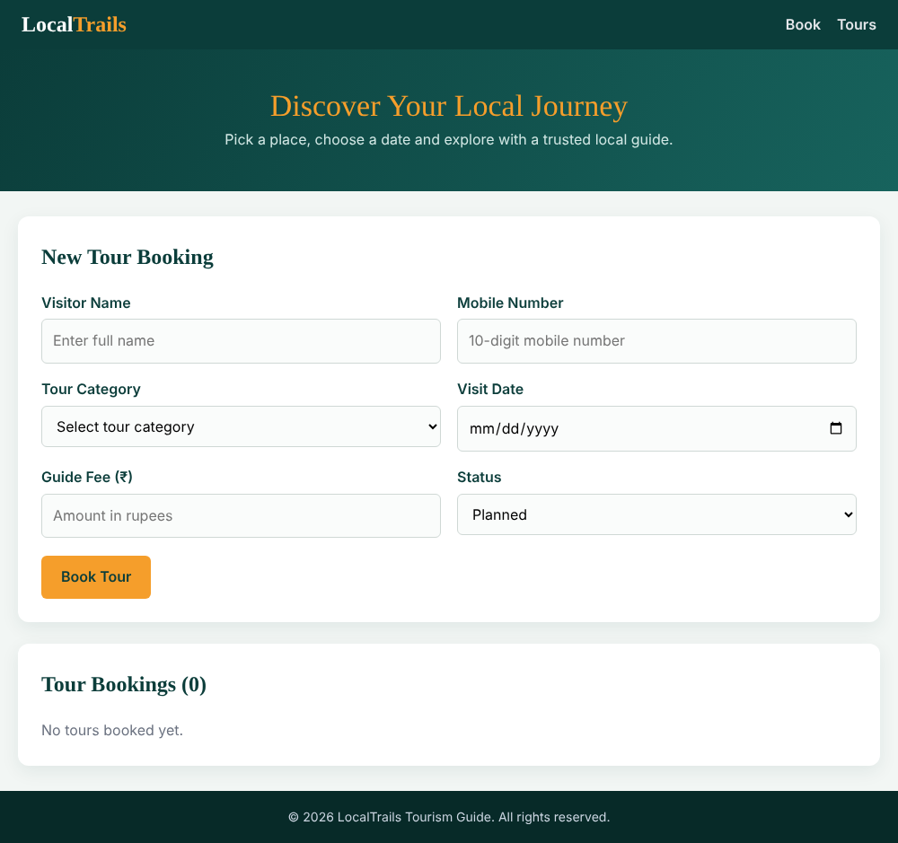
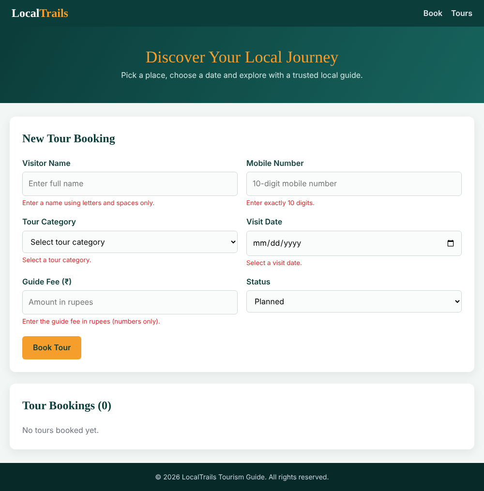
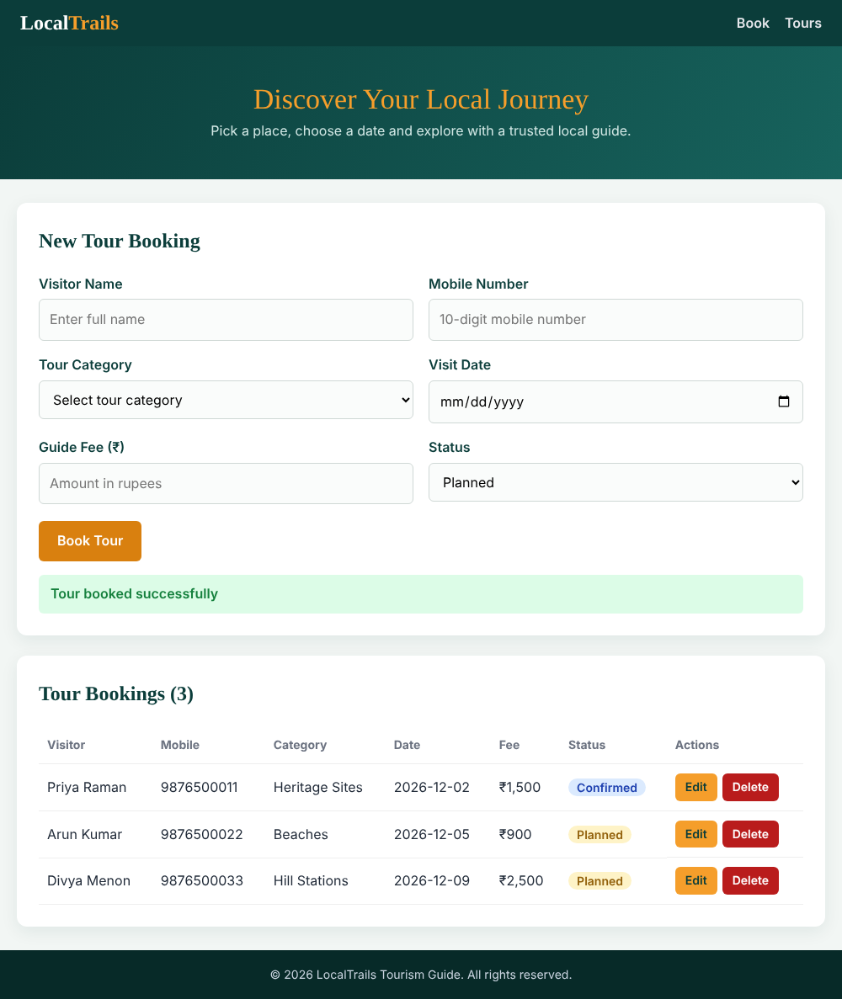
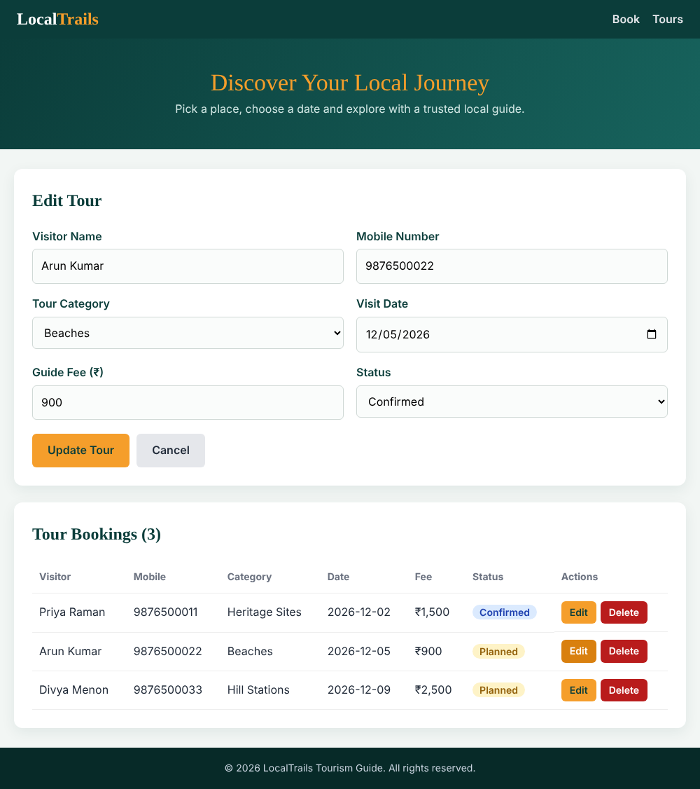
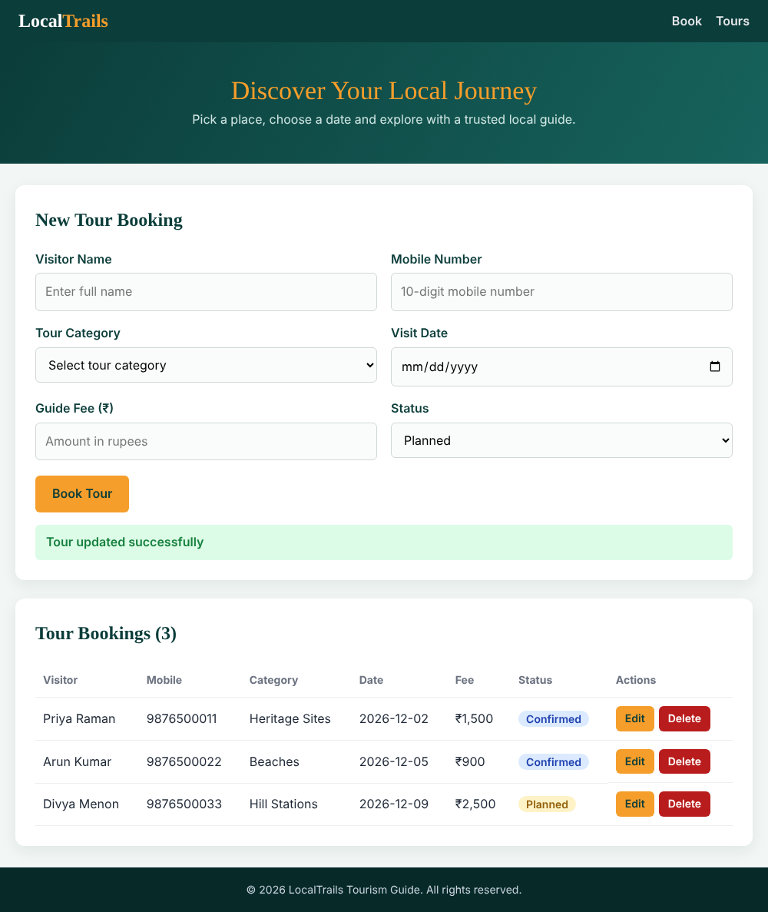
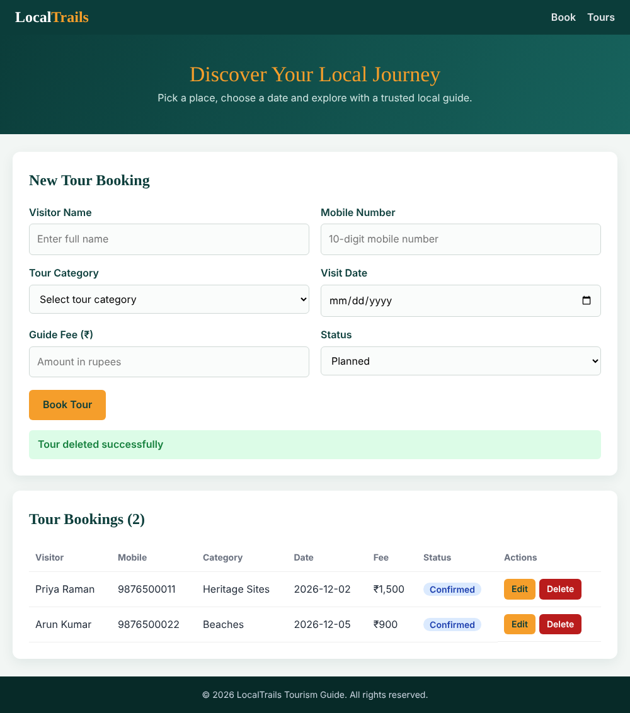

# LocalTrails - Local Tourism Guide 🧭

A full-stack local tourism web application built with **React**, **Vite**, **Node.js/Express**, and **MongoDB**. When deployed as a static site (e.g., GitHub Pages), it automatically falls back to browser storage (`localStorage`) so visitors can interact with all tour booking features without requiring a live backend server.

---

## 🌐 Live Website
**[https://harshad062.github.io/EXP-12/](https://harshad062.github.io/EXP-12/)**

---

## 🚀 Features
- **Tour Booking Form**: Add bookings with visitor name, 10-digit mobile number, category, tour date, status, and fee.
- **Interactive Tour Management (CRUD)**:
  - View all booked tours sorted chronologically.
  - Edit booking details (status, category, fee, date, etc.).
  - Delete tour bookings with instant UI update.
- **Dual Mode Data Store**:
  - **Local Full-Stack**: Connects to Node.js/Express backend with MongoDB database (`TourismGuideDB`).
  - **Static Web / GitHub Pages**: Automatically switches to client-side storage (`localStorage`) with pre-populated sample tours.
- **Responsive Modern UI**: Clean styling for desktop and mobile devices.

---

## 🛠️ Tech Stack
- **Frontend**: React 18, Vite 5, Modern CSS
- **Backend**: Node.js, Express, CORS
- **Database**: MongoDB (via official `mongodb` driver)
- **Deployment**: GitHub Pages (Client demo)

---

## 💻 Local Development

### Prerequisites
- Node.js (v18 or higher)
- MongoDB Community Server (running locally at `mongodb://127.0.0.1:27017` or via `MONGO_URI`)

### 1. Start the Frontend
```bash
cd frontend
npm install
npm run dev
```

### 2. Build Frontend for Production
```bash
cd frontend
npm install
npm run build
```

### 3. Start the Backend Server
```bash
cd backend
npm install
node server.js
```
Open **[http://localhost:3000](http://localhost:3000)** in your browser.

---

## 📸 Screenshots

| Booking Management | Edit / Update Tour |
| :---: | :---: |
|  |  |

| Categories & Filters | Database Records |
| :---: | :---: |
|  |  |

| Responsive Layout | Completed Tour Status |
| :---: | :---: |
|  |  |

---

## 📄 License
MIT License. Created for Local Tourism Guide Experiment (EXP-12).
